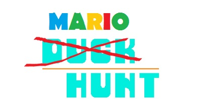

# Duck Hunt (Turing)

A Duck Hunt parody written by Benoît Lafrance in Turing 4.1.1 for a high school computer science class in November 2016. Instead of ducks, you shoot Mario as he bounces around the window.

## Gameplay

- The title screen has two buttons, **PLAY lvl : 1** and **PLAY lvl : 2**.
- A crosshair follows the mouse.
- **Level 1:** one Mario bounces off the edges of the window. Click on him to win, which plays an explosion and then a "Bravo" screen.
- **Level 2:** two Marios bounce at different speeds.
- Background music starts as soon as the program opens.

## Running it

- **Compiled build:** run `duckhunt.exe` from this folder. It loads the images at runtime, so they have to stay beside it.
- **From source:** open `Unnamed.t` in Turing 4.1.1 and run it.

## Files

| File | Purpose |
| --- | --- |
| `Unnamed.t` | Source code (comments in French) |
| `duckhunt.exe` | Compiled Windows build |
| `tt.jpg` | Title art |
| `m.jpg` | Mario sprite |
| `ex.jpg` | Explosion shown on a hit |
| `b.jpg` | "Bravo" win screen |

## Not included

- `s.mp3`, the background music, is a 30-minute track that isn't mine, so it's left out. Any MP3 renamed to `s.mp3` and placed in this folder will play in its place.
- `gg.jpg`, the level 2 win image, is loaded by the code but was missing from the saved project, so level 2 can't show its end screen.

## Known quirks, kept as written

- Level 2 resets its hit count every frame, so both Marios have to be under the cursor in the same click.
- `hit2`, a two-explosion animation, is defined but never called.

Mario and Duck Hunt are trademarks of Nintendo. This is a student fan project with no affiliation.
